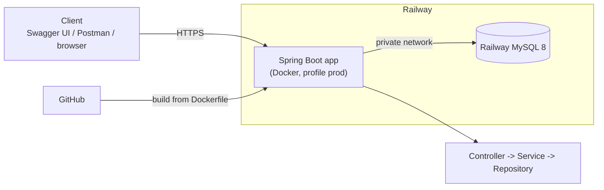

# Cab Booking Management System

CrunchyCode Java Backend Developer Internship, **Task 5 (Full Track): Capstone, ship it to production**.

A secured REST API for managing **drivers**, **rides** and **vehicle types**. It runs in a Docker container on **Railway** with a
managed **Railway MySQL 8** database, and documents itself with **Swagger UI**.

> ### Live links (fill in after you have deployed AND tested them)
> | | URL | Verified? |
> |---|---|---|
> | Live API base URL | `https://YOUR-RAILWAY-DOMAIN` | not yet |
> | Health check | `https://YOUR-RAILWAY-DOMAIN/actuator/health` | not yet |
> | Swagger UI | `https://YOUR-RAILWAY-DOMAIN/swagger-ui/index.html` | not yet |
> | OpenAPI JSON | `https://YOUR-RAILWAY-DOMAIN/v3/api-docs` | not yet |
> | Demo video (3 min) | _add link after recording_ | not yet |
>
> These are placeholders. Replace `YOUR-RAILWAY-DOMAIN` with the domain Railway gives you, open each link, and change "not yet" to the date you checked it.

GitHub repository: `https://github.com/sameerkr056/crunchy-java-backend-t5-sameer`

## Features

- Register and log in, **JWT** tokens that always expire, passwords hashed with **BCrypt**
- Two roles: `USER` (read, create and edit rides) and `ADMIN` (everything), enforced with `@PreAuthorize`
- Drivers, rides (with status rules: REQUESTED, ACCEPTED, COMPLETED, CANCELLED) and vehicle types
- One-to-many (driver and rides) and many-to-many (drivers and vehicle types) relationships
- **Pagination and sorting** on every list endpoint
- N+1 query problem demonstrated and fixed (see [QUERIES.md](QUERIES.md))
- **Flyway** migrations create and change the schema automatically at startup
- Same JSON error format everywhere, never a stack trace
- **Swagger UI** with an Authorize button for the JWT
- **Docker** image, Railway deployment configuration, health check
- Unit tests (Mockito), integration tests (MockMvc), a MySQL migration test (Testcontainers) and JaCoCo coverage of at least 60%

## Technology stack

| Area | Technology |
|------|------------|
| Language / build | Java 21, Maven (wrapper included) |
| Framework | Spring Boot 3.5.7, Spring Web, Validation, Actuator |
| Security | Spring Security 6, JJWT 0.12.6, BCrypt |
| Database | MySQL 8 (local MySQL Server + MySQL Workbench, production Railway MySQL) |
| Persistence | Spring Data JPA, Hibernate 6.6, Flyway |
| API docs | Springdoc OpenAPI 2.8.9 (Swagger UI) |
| Deployment | Docker, Railway |
| Tests | JUnit 5, Mockito, MockMvc, Testcontainers, JaCoCo |

## Architecture



More diagrams (layers, login flow, database) are in [docs/ARCHITECTURE.md](docs/ARCHITECTURE.md).

## Project structure

```
crunchy-java-backend-t5-sameer
├── Dockerfile                      multi-stage build (Maven, then a small Java 21 runtime)
├── .dockerignore
├── railway.json                    Railway: build with Dockerfile, health check /actuator/health
├── .env.example                    variable NAMES only, no secrets
├── pom.xml
├── README.md, QUERIES.md, DEMO_SCRIPT.md
├── .github/workflows/ci.yml        optional CI (runs mvnw verify on GitHub)
├── docs/
│   ├── ARCHITECTURE.md, PERFORMANCE.md, COVERAGE.md, SCREENSHOTS.md
│   ├── screenshots/                add your screenshots here
│   └── jacoco/                     created by "mvnw verify" (HTML coverage report)
├── postman/Cab-Booking-Task5.json
├── scripts/
│   ├── measure-performance.ps1     times the list endpoints
│   └── perf/                       seed-1000.sql, cleanup-perf-data.sql, explain-queries.sql
└── src
    ├── main/resources
    │   ├── application.properties          local settings (everything sensitive from environment variables)
    │   ├── application-prod.properties     production settings
    │   └── db/migration/V1 ... V10         Flyway migrations
    ├── main/java/com/crunchycode/cabbooking
    │   ├── controller, service, repository, model, dto, exception
    │   ├── security/   JWT, filter, SecurityConfig, 401/403 handlers
    │   └── config/     OpenApiConfig, ProtectedEndpointResponseCustomizer, AdminInitializer
    └── test/java/...   unit tests, MockMvc tests, config tests, integration (Testcontainers) test
```

## Environment variables

Nothing sensitive is stored in the repository. The app reads everything from environment variables.
Spring Boot does **not** read `.env` files by itself, so `.env.example` only lists the names.

| Variable | Required | Example (placeholder) | Meaning |
|----------|:--------:|-----------------------|---------|
| `DB_HOST` | local: no (localhost) | `localhost` | MySQL host |
| `DB_PORT` | no | `3306` | MySQL port |
| `DB_NAME` | no | `cabbooking_db` | database name |
| `DB_USERNAME` | no | `root` | database user |
| `DB_PASSWORD` | **yes** | `<your-password>` | database password |
| `JWT_SECRET` | **yes** | `<base64-text>` | signing key, Base64 of at least 32 random bytes. The app will not start without it |
| `JWT_EXPIRATION_MINUTES` | no | `60` | token lifetime, must be greater than 0 |
| `ADMIN_USERNAME` | to get an admin | `<admin-name>` | first ADMIN account, created at startup if missing |
| `ADMIN_EMAIL` | no | `<admin-email>` | email of that admin |
| `ADMIN_PASSWORD` | to get an admin | `<strong-password>` | password of that admin (min 8 characters) |
| `DB_OPTIONS` | no | `useSSL=true&requireSSL=true` | extra JDBC options (default `useSSL=false&allowPublicKeyRetrieval=true`) |
| `PORT` | set by Railway | `8080` | HTTP port. Locally 8080 |
| `SPRING_PROFILES_ACTIVE` | set by Docker image | `prod` | production settings |

Generate a JWT secret in PowerShell:

```powershell
[Convert]::ToBase64String((1..32 | ForEach-Object { Get-Random -Maximum 256 }))
```

Never commit a real `.env`. It is listed in `.gitignore`, and a test (`ProductionConfigurationTest`) fails if a password or secret is hardcoded in the property files.

## Local setup with MySQL Workbench (Windows 11)

1. **Install MySQL 8.0.16 or newer** (MySQL Installer: "MySQL Server" and "MySQL Workbench"). Remember the `root` password.
2. **Open MySQL Workbench** -> click your local connection (usually "Local instance MySQL80") -> enter the password.
3. **Create the database.** Open a new SQL tab and run, then click the lightning bolt:

```sql
CREATE DATABASE cabbooking_db CHARACTER SET utf8mb4 COLLATE utf8mb4_unicode_ci;
```

4. **Set the environment variables in IntelliJ:** Run -> Edit Configurations -> `CabBookingApplication` -> **Environment variables**, paste (use your own values):

```
DB_PASSWORD=your_mysql_password;JWT_SECRET=your_generated_secret;ADMIN_USERNAME=admin1;ADMIN_EMAIL=you@example.com;ADMIN_PASSWORD=your_strong_password
```

5. **Run** `CabBookingApplication`. In the console you should see Flyway applying `V1` ... `V10` and then `Started CabBookingApplication`.
6. **Check in Workbench:** refresh the Schemas panel. You should see the tables `drivers`, `rides`, `vehicle_types`, `driver_vehicle_types`, `users` and `flyway_schema_history`. Run:

```sql
SELECT version, description, success FROM flyway_schema_history ORDER BY installed_rank;
```

   All 10 rows must show `success = 1`.
7. Open `http://localhost:8080/swagger-ui/index.html` and `http://localhost:8080/actuator/health`.

Or from PowerShell (variables only live in that window):

```powershell
$env:DB_PASSWORD = "your_mysql_password"
$env:JWT_SECRET = "your_generated_secret"
$env:ADMIN_USERNAME = "admin1"
$env:ADMIN_PASSWORD = "your_strong_password"
.\mvnw.cmd spring-boot:run
```

Local runs use no profile, so SQL logging stays on (useful for the N+1 experiment in `QUERIES.md`).

## Flyway migrations

Files in `src/main/resources/db/migration` run once, in order, when the app starts (also on Railway). Flyway remembers them in `flyway_schema_history`.

| Migration | Purpose |
|-----------|---------|
| V1 to V4 | `drivers`, `rides`, `vehicle_types`, `driver_vehicle_types` |
| V5 to V8 | sample data: 7 vehicle types, 25 drivers, 75 rides, 52 links |
| V9 | `users` table (login) |
| V10 | performance indexes (see [docs/PERFORMANCE.md](docs/PERFORMANCE.md)) |

`spring.jpa.hibernate.ddl-auto=validate`: Hibernate only checks that the entities match the tables. Never edit a migration that already ran; add a new `V11__...sql` instead.
The sample data (V5 to V8) is also created in the production database, which is handy for a demo.

## Docker

The `Dockerfile` builds the jar inside Docker (no Java needed on the build machine) and runs it on a small Java 21 image as a non-root user with the `prod` profile.

Install **Docker Desktop** for Windows, start it, then in PowerShell:

```powershell
# build the image
docker build -t crunchy-java-backend-t5-sameer .

# run it against your LOCAL MySQL (Docker reaches your PC through host.docker.internal)
docker run --rm -p 8080:8080 `
  -e DB_HOST=host.docker.internal `
  -e DB_PASSWORD=your_mysql_password `
  -e JWT_SECRET=your_generated_secret `
  -e ADMIN_USERNAME=admin1 -e ADMIN_PASSWORD=your_strong_password `
  crunchy-java-backend-t5-sameer
```

Then open `http://localhost:8080/swagger-ui/index.html`. (You can also put the names in a `.env` file and use `--env-file .env`; keep that file out of Git.)

## Railway deployment (step by step)

Railway needs **your account**, possibly a payment method or credit, so these steps are done by you in the browser. Nothing below has been run for you.

### A. Put the code on GitHub

```powershell
cd path\to\crunchy-java-backend-t5-sameer
git init
git add .
git status          # check: no .env file and no target folder in the list!
git commit -m "Task 5: Docker, Railway, Swagger, performance"
git branch -M main
git remote add origin https://github.com/sameerkr056/crunchy-java-backend-t5-sameer.git
git push -u origin main
```

(Create the empty repository `crunchy-java-backend-t5-sameer` on github.com first, without a README.)

### B. Create the Railway project and the database

1. Go to railway.com, log in with GitHub.
2. **New Project** -> **Deploy from GitHub repo** -> choose `crunchy-java-backend-t5-sameer`. Railway sees the `Dockerfile` and `railway.json` and builds with Docker. (The first deploy will fail at startup because there is no database and no `JWT_SECRET` yet. That is expected.)
3. In the project canvas click **+ New** -> **Database** -> **Add MySQL**. Keep the service name `MySQL`. Railway creates a managed MySQL database.
4. Check the MySQL version: open the MySQL service -> **Database** (or Data) tab -> run `SELECT VERSION();`. It should start with 8.

### C. Connect the app to the database with variables

Open your **app service** -> **Variables** -> **New Variable** (or "Raw Editor"). Railway can reference the database service's variables:

| Variable | Value |
|----------|-------|
| `DB_HOST` | `${{MySQL.MYSQLHOST}}` |
| `DB_PORT` | `${{MySQL.MYSQLPORT}}` |
| `DB_NAME` | `${{MySQL.MYSQLDATABASE}}` |
| `DB_USERNAME` | `${{MySQL.MYSQLUSER}}` |
| `DB_PASSWORD` | `${{MySQL.MYSQLPASSWORD}}` |
| `JWT_SECRET` | your own generated Base64 secret (never reuse your local one in public) |
| `JWT_EXPIRATION_MINUTES` | `60` |
| `ADMIN_USERNAME` | your admin username |
| `ADMIN_EMAIL` | your admin email |
| `ADMIN_PASSWORD` | a strong password |

If your MySQL service has a different name than `MySQL`, use that name inside `${{ ... }}`. If the variable names differ, open the MySQL service's **Variables** tab and copy the exact names. Do not set `PORT`: Railway sets it.
The app and the database must be in the same Railway project and environment so that `MYSQLHOST` (a private `*.railway.internal` address) works.

Railway redeploys automatically after you save the variables.

### D. Public HTTPS address

App service -> **Settings** -> **Networking** -> **Generate Domain**. You get `https://something.up.railway.app` with HTTPS included. If it asks for a port, use the value of the `PORT` variable shown in the service (the app listens on `PORT`).
Also in Settings: choose the **region** closest to you (for example Southeast Asia for India) and make sure **Serverless / App Sleeping** is off, so the app does not sleep.

### E. Check the deployment (PowerShell)

Look at **Deployments -> View logs**: you should see Flyway lines (`Successfully applied 10 migrations` or similar) and `Started CabBookingApplication`. If you see `Could not resolve placeholder 'JWT_SECRET'` or `Access denied`, a variable is missing or wrong.

```powershell
$base = "https://YOUR-RAILWAY-DOMAIN"
Invoke-RestMethod "$base/actuator/health"                     # expect status UP
Invoke-WebRequest "$base/swagger-ui/index.html" -UseBasicParsing | Select-Object StatusCode   # expect 200
Invoke-RestMethod "$base/v3/api-docs" | Select-Object -ExpandProperty openapi

# log in as the admin you configured
$body = @{ username = "YOUR_ADMIN_USERNAME"; password = "YOUR_ADMIN_PASSWORD" } | ConvertTo-Json
$login = Invoke-RestMethod -Method Post -Uri "$base/api/v1/auth/login" -ContentType "application/json" -Body $body
$headers = @{ Authorization = "Bearer $($login.token)" }
Invoke-RestMethod "$base/api/v1/drivers?page=0&size=5" -Headers $headers
```

Only after these calls work can you write the real URL into the "Live links" table at the top.

### F. Check that data persists

Create something (for example a vehicle type in Swagger), then in Railway click **Redeploy** on the app. After it is back, list vehicle types again: your record must still be there, because the data lives in the Railway MySQL service, not in the app container.

### G. Inspect Railway MySQL with MySQL Workbench

Railway's database is private by default. To look at it from your PC: MySQL service -> **Settings -> Networking -> TCP Proxy** (enable it) or **Connect** tab -> public connection details (host like `xxx.proxy.rlwy.net`, a port, user, password). In MySQL Workbench: **+** (new connection) -> Hostname, Port, Username, **Store in Vault** the password, SSL: "Use SSL if available" -> Test Connection. Your local MySQL stays untouched.
Treat these credentials like secrets, and turn the TCP proxy off again when you are done if you do not need it.

### H. Load 1,000 records and measure

Follow [docs/PERFORMANCE.md](docs/PERFORMANCE.md): run `scripts/perf/seed-1000.sql` in Workbench (connected to Railway), then `scripts/measure-performance.ps1` against the live URL.

## API overview

Base URL: `https://YOUR-RAILWAY-DOMAIN` (or `http://localhost:8080`). Full interactive documentation: **`/swagger-ui/index.html`**.
All endpoints except the ones marked "public" need `Authorization: Bearer <token>`.

### Public

| Method | URL | Description |
|--------|-----|-------------|
| POST | `/api/v1/auth/register` | create a USER account (201) |
| POST | `/api/v1/auth/login` | get a JWT (200) |
| GET | `/swagger-ui/index.html` | Swagger UI |
| GET | `/v3/api-docs` | OpenAPI JSON |
| GET | `/actuator/health` | health check (app + database) |

### Protected

| Method | URL | USER | ADMIN | Success |
|--------|-----|:----:|:-----:|---------|
| POST | `/api/v1/drivers` | no | yes | 201 |
| GET | `/api/v1/drivers` (paginated, `?available=`) | yes | yes | 200 |
| GET | `/api/v1/drivers/with-rides` (`?mode=naive\|optimized`) | yes | yes | 200 |
| GET | `/api/v1/drivers/{id}` | yes | yes | 200 |
| PUT | `/api/v1/drivers/{id}` | no | yes | 200 |
| DELETE | `/api/v1/drivers/{id}` | no | yes | 204 |
| GET | `/api/v1/drivers/{id}/vehicle-types` (paginated) | yes | yes | 200 |
| PUT | `/api/v1/drivers/{id}/vehicle-types/{vehicleTypeId}` | no | yes | 204 |
| DELETE | `/api/v1/drivers/{id}/vehicle-types/{vehicleTypeId}` | no | yes | 204 |
| POST | `/api/v1/rides` | yes | yes | 201 |
| GET | `/api/v1/rides` (paginated, `?status=&driverId=`) | yes | yes | 200 |
| GET | `/api/v1/rides/{id}` | yes | yes | 200 |
| PUT | `/api/v1/rides/{id}` (only REQUESTED rides) | yes | yes | 200 |
| DELETE | `/api/v1/rides/{id}` | no | yes | 204 |
| PATCH | `/api/v1/rides/{id}/accept` | no | yes | 200 |
| PATCH | `/api/v1/rides/{id}/status` (COMPLETED or CANCELLED) | no | yes | 200 |
| POST | `/api/v1/vehicle-types` | no | yes | 201 |
| GET | `/api/v1/vehicle-types` (paginated) | yes | yes | 200 |
| GET | `/api/v1/vehicle-types/{id}` | yes | yes | 200 |
| PUT | `/api/v1/vehicle-types/{id}` | no | yes | 200 |
| DELETE | `/api/v1/vehicle-types/{id}` | no | yes | 204 |
| GET | `/api/v1/vehicle-types/{id}/drivers` (paginated) | yes | yes | 200 |

Common error codes: `400` invalid input, `401` missing/invalid token, `403` wrong role, `404` not found, `409` rule conflict (duplicate, invalid ride status change, driver still has rides).

### Pagination

Every list endpoint accepts the same parameters:

| Parameter | Default | Rule |
|-----------|---------|------|
| `page` | `0` | 0 or more |
| `size` | `10` | 1 to 100 |
| `sortBy` | `id` | only fields allowed for that endpoint (otherwise 400 listing the allowed ones) |
| `direction` | `asc` | `asc` or `desc` |

```
GET /api/v1/drivers?page=0&size=10&sortBy=name&direction=asc
```

```json
{ "content": [ { "id": 1, "name": "Ravi Kumar", "available": true } ],
  "page": 0, "size": 10, "totalElements": 25, "totalPages": 3, "first": true, "last": false }
```

### Error format (same everywhere)

```json
{ "timestamp": "2026-11-17T10:15:30.123", "status": 403,
  "message": "You do not have permission to perform this action", "path": "/api/v1/drivers/1" }
```

## JWT authentication guide

1. **Register** (becomes a USER; the role cannot be chosen):

```powershell
$base = "http://localhost:8080"      # or your Railway URL
$reg = @{ username = "student1"; email = "student1@example.com"; password = "StrongPass1" } | ConvertTo-Json
Invoke-RestMethod -Method Post -Uri "$base/api/v1/auth/register" -ContentType "application/json" -Body $reg
```

2. **Log in** and keep the token:

```powershell
$cred = @{ username = "student1"; password = "StrongPass1" } | ConvertTo-Json
$login = Invoke-RestMethod -Method Post -Uri "$base/api/v1/auth/login" -ContentType "application/json" -Body $cred
$login.token
```

3. **Call a protected endpoint** with the header:

```powershell
$headers = @{ Authorization = "Bearer $($login.token)" }
Invoke-RestMethod "$base/api/v1/drivers?page=0&size=5" -Headers $headers
```

4. **In Swagger UI:** `POST /api/v1/auth/login` -> copy the `token` -> click **Authorize** -> paste -> **Authorize**. All "locked" endpoints now send the token.
5. **ADMIN:** the first admin is created at startup from `ADMIN_USERNAME` / `ADMIN_PASSWORD`. Log in with those values to get an ADMIN token.

Expected behaviour: no or bad token -> `401`; a USER calling an ADMIN endpoint -> `403`.
A token holds the username and role and expires after `JWT_EXPIRATION_MINUTES` (default 60).

## Performance results

Target: **under 500 ms with 1,000 records**, with indexes and pagination on every list endpoint.

Status: indexes (`V10`), pagination, the test-data script and the measuring script are ready. **No measurement has been run yet**, so no result is claimed here.
Run the steps in [docs/PERFORMANCE.md](docs/PERFORMANCE.md) and copy the final numbers into this table:

| Endpoint (1,000+ records, page size 20) | Max ms (Railway) | Under 500 ms? |
|------------------------------------------|------------------|---------------|
| `GET /api/v1/drivers` | _fill in_ | _fill in_ |
| `GET /api/v1/rides` | _fill in_ | _fill in_ |
| `GET /api/v1/vehicle-types` | _fill in_ | _fill in_ |
| `GET /api/v1/drivers/with-rides` | _fill in_ | _fill in_ |

## Testing

```powershell
.\mvnw.cmd clean verify
```

This runs all tests, writes the JaCoCo HTML report to `docs\jacoco\index.html`, and **fails if line coverage is below 60%**.

| Kind | Classes | What it checks |
|------|---------|----------------|
| Unit tests (JUnit 5 + Mockito) | `DriverServiceTest`, `RideServiceTest`, `VehicleTypeServiceTest`, `AuthServiceTest`, `JwtServiceTest`, `CustomUserDetailsServiceTest`, `AdminInitializerTest`, `PageParamsTest`, `OpenApiConfigTest` | business rules, BCrypt, JWT, Swagger config |
| Config tests | `ProductionConfigurationTest` | no hardcoded secrets, env variables, prod profile, `.env` ignored, Dockerfile |
| MockMvc tests | `AuthControllerTest`, `DriverControllerTest`, `RideControllerTest`, `VehicleTypeControllerTest`, `PublicEndpointsSecurityTest` | happy paths, **401 / 403 on every protected endpoint**, error format, Swagger and health are public |
| Database test (Testcontainers) | `DatabaseMigrationIntegrationTest` | real MySQL 8: all Flyway migrations, Hibernate validation, indexes, Swagger, health, login and roles end to end |

The database test needs **Docker Desktop running**. Without Docker it is skipped (not failed). The other tests need no database and no environment variables.
Postman: import `postman/Cab-Booking-Task5.json`, set `baseUrl`, `adminUsername`, `adminPassword`, and run the collection (see its description).
More on coverage: [docs/COVERAGE.md](docs/COVERAGE.md).

## Known limitations

- **Not verified by the author of this file:** the Railway deployment, the live URLs, the performance numbers, the JaCoCo report and the demo video must be created and checked by you (see the checklists above).
- No logout or refresh tokens. A token stays valid until it expires, even if the user's role changes or the account is deleted.
- No protection against repeated wrong passwords (no rate limiting) and anyone can self-register as a USER.
- Swagger UI and the OpenAPI JSON are public so that the API can be explored; the API itself is protected.
- Sample data from migrations `V5` to `V8` is also created in production.
- One app instance only. Times are stored in UTC (Railway's default time zone).
- Duplicate checks use case-insensitive comparisons (`upper(...)`), which cannot use an index; fine for this size.
- Railway's free or trial credits can run out, and the app then stops. Check your plan before the demo.
- The MySQL TCP proxy used for MySQL Workbench is public and password-protected only; turn it off when not needed.
- CI (`.github/workflows/ci.yml`) is optional and has not been run.

## Previous tasks

Task 3 (MySQL, JPA, Flyway, pagination, N+1) is explained in [QUERIES.md](QUERIES.md). Task 4 (security and tests) is part of this project: all features still work.
