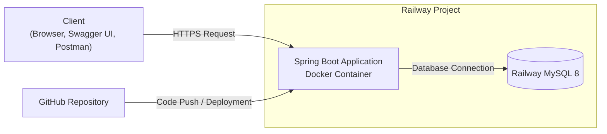
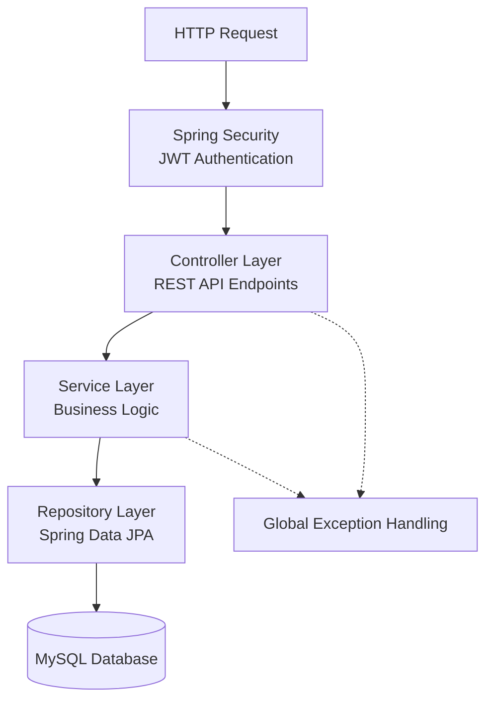
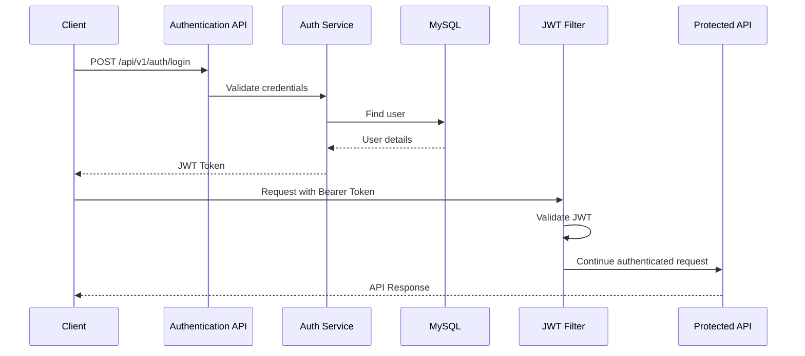
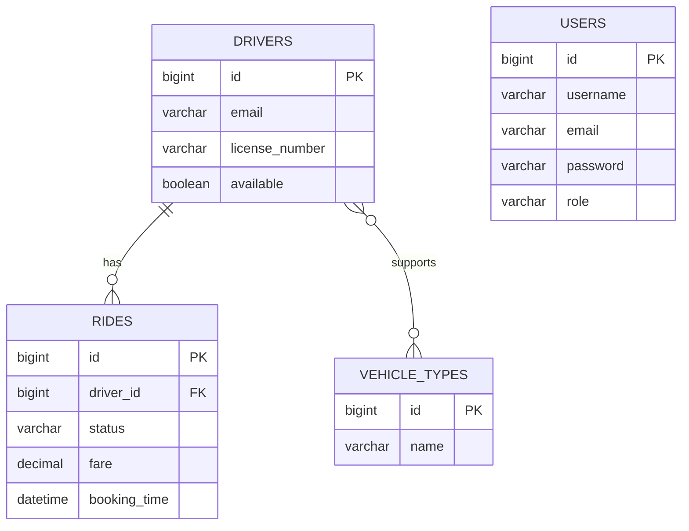
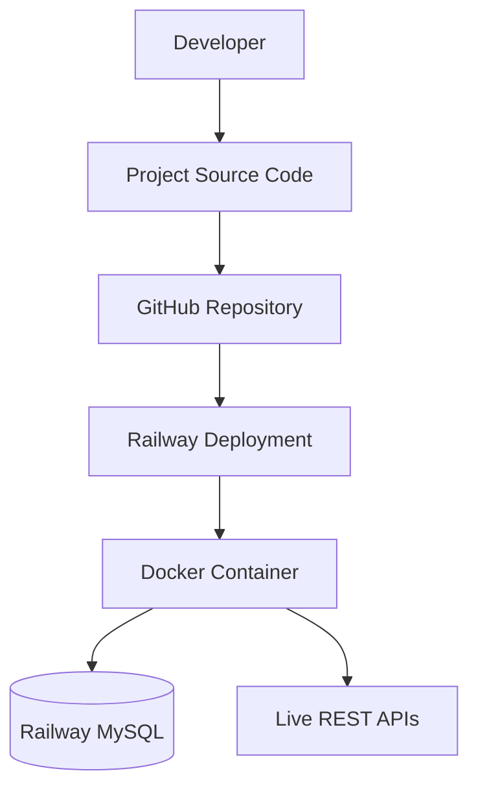

# Architecture

## 1. Overall Architecture (Production)

The application is deployed on Railway and uses Railway MySQL for database storage.



- The Spring Boot application is deployed on Railway.
- Railway provides a public HTTPS URL for accessing the APIs.
- The application connects to Railway MySQL for database operations.
- The GitHub repository contains the application source code and Dockerfile.

## 2. Internal Application Architecture

The application follows a layered architecture. Each layer has a separate responsibility.



### Layer Responsibilities

| Layer | Package | Responsibility |
|---|---|---|
| Controller | `controller` | Handles HTTP requests and responses |
| Service | `service` | Contains application business logic |
| Repository | `repository` | Performs database operations using Spring Data JPA |
| Entity | `entity` | Defines database entities such as Driver, Ride and VehicleType |
| DTO | `dto` | Handles request and response data |
| Security | `security` | Handles JWT authentication and security-related operations |
| Configuration | `config` | Contains application configuration |
| Exception | `exception` | Handles application exceptions |

## 3. Authentication Flow

The application uses JWT-based authentication to secure protected APIs.



**Authentication steps:**

1. The user sends login credentials.
2. The application validates the credentials.
3. After successful login, a JWT token is generated.
4. The client sends the token in the Authorization header.
5. The JWT filter validates the token before allowing access to protected endpoints.

Authorization header example:

```http
Authorization: Bearer <your-jwt-token>
```

## 4. Database Architecture

The application uses MySQL 8 to store driver, ride, vehicle type and user information.



- A driver can have multiple rides.
- Each ride is associated with a driver through `driver_id`.
- Drivers can be associated with vehicle types.
- User records are used for authentication and authorization.

### Database Migrations

Flyway manages database schema changes through versioned migration scripts.

Migration files are stored in:

```text
src/main/resources/db/migration/
```

The project contains migration scripts from `V1` to `V10`.

## 5. Local vs Production Environment

| Configuration | Local Environment | Production Environment |
|---|---|---|
| Application | Spring Boot | Spring Boot on Railway |
| Database | Local MySQL | Railway MySQL |
| Port | 8080 | Railway-provided port |
| Configuration | Local application configuration | Railway environment variables |
| Database migrations | Flyway | Flyway |
| API access | Localhost | Public HTTPS URL |

Both environments use the same application code and database migration structure. Database connection settings are configured according to the environment.

## 6. Deployment Workflow



The source code is maintained in GitHub and deployed on Railway using Docker. The deployed application connects to Railway MySQL and exposes REST APIs through its public URL.