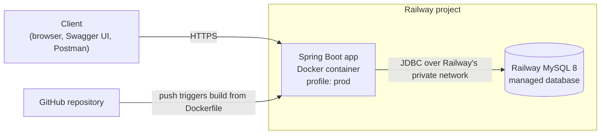
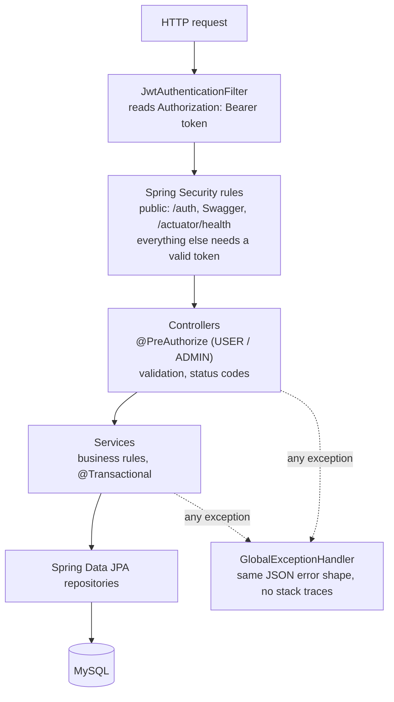
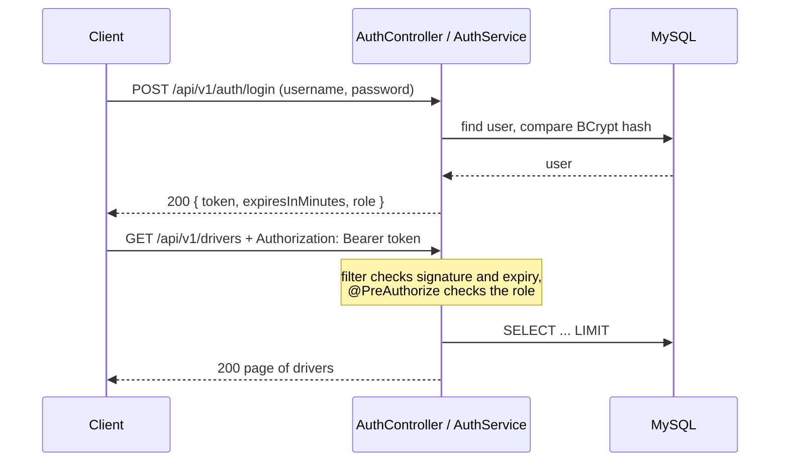
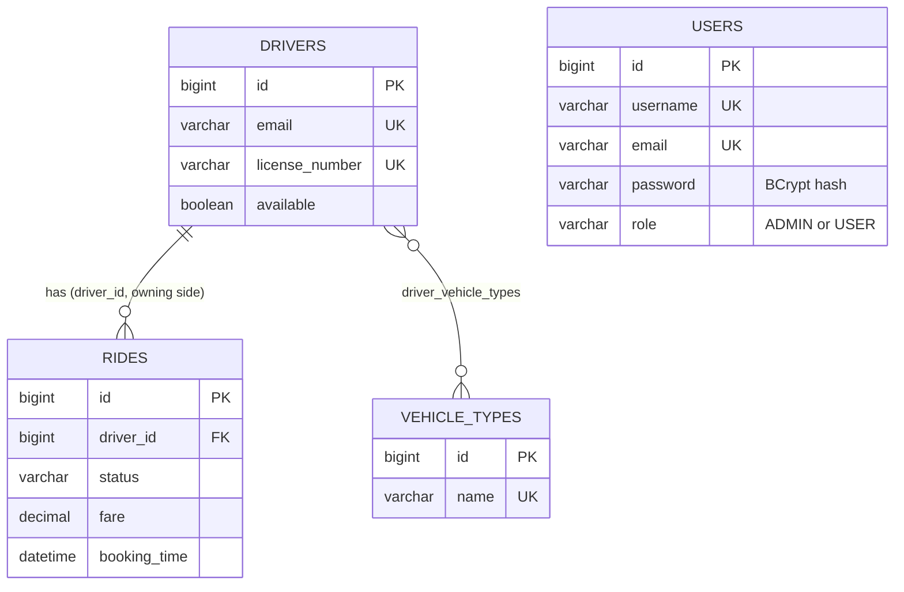

# Architecture

## 1. Big picture (production)

- Railway builds the image from the `Dockerfile` in the repository and runs it.
- The public HTTPS address is created by Railway (it ends HTTPS at its proxy and forwards plain HTTP to the container).
- The app talks to MySQL over the private network; the database is not meant to be used by browsers.

## 2. Inside the application

| Layer | Package | Job |
|-------|---------|-----|
| Security | `security` | JWT creation and checking, filter, BCrypt, 401 / 403 JSON answers |
| Controller | `controller` | HTTP only. Role rules with `@PreAuthorize`. Swagger annotations |
| Service | `service` | All business rules (ride status changes, driver availability, duplicates) |
| Repository | `repository` | Spring Data JPA, paging, the JOIN FETCH query for the N+1 fix |
| Model | `model` | JPA entities (`Driver`, `Ride`, `VehicleType`, `AppUser`) |
| DTO | `dto` | Request and response classes. Entities are never returned directly |
| Config | `config` | OpenAPI settings, first admin account |
| Exception | `exception` | Custom exceptions and the global handler |

## 3. Login and token flow

## 4. Database

Flyway owns the schema (`V1` to `V10`). Hibernate only validates it (`ddl-auto=validate`).

## 5. Local versus production

| | Local | Production (Railway) |
|---|---|---|
| Database | MySQL Server on your PC, managed with MySQL Workbench | Railway MySQL |
| Profile | none (default) | `prod` (set in the Dockerfile) |
| Port | 8080 | `PORT` given by Railway |
| SQL logging | on (to study the N+1 problem) | off |
| Config source | IntelliJ environment variables | Railway service variables |
| Same in both | MySQL 8, Flyway migrations, code, JWT rules | |
